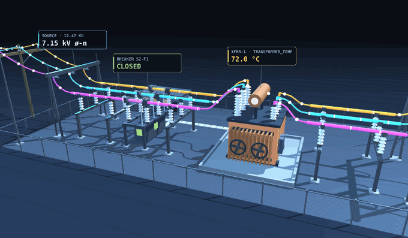
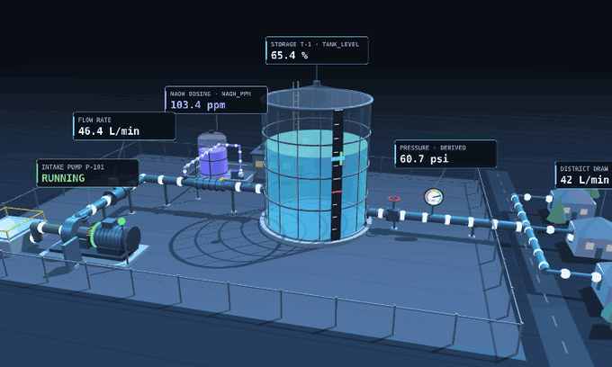

# ICS Twin: Grid Substation and Water Treatment

Two browser-based digital twins of small industrial control systems (ICS): a **12.47 kV distribution substation feeder** and a **municipal water-treatment plant**. Each twin models a plant's normal operation, couples its telemetry tags to a single driving factor so the data behave like a real process rather than independent noise, and renders the result in two views: a 2.5D isometric one-line and a 3D yard.

> **See it in 30 seconds:** open [`twin/grid_twin.html`](twin/grid_twin.html) or [`twin/water_twin.html`](twin/water_twin.html) in a browser. Each runs a built-in simulator; no hardware, server, or install is required.

## The grid substation twin



Eleven telemetry tags (three-phase voltage and current, frequency, power factor, real power, transformer temperature, and breaker status) all ride one slow-moving **load factor**. As load rises, voltage sags, current rises, and the transformer heats along a first-order integrator, the same coupling the field firmware uses.

The operator panel supports a planned **switching operation**: opening the breaker de-energizes the feeder, so current and real power fall to zero while the bus stays energized and the transformer cools.

Beyond the simulator, the twin can also read live telemetry, read-only, from any MQTT-over-WebSocket broker that publishes the documented `grid/<tag>` topics, or replay historical points from a CSV.

## The water treatment twin



Four process tags (`naoh_ppm`, `flow_rate`, `tank_level`, and `pump_state`) plus a derived `pressure` indicator all ride one **district demand** factor. The intake pump balances district draw to hold the storage tank in band, and caustic (NaOH) dosing tracks flow to hold roughly 100 ppm.

Taking the pump out of service shows the process dynamics an operator has to manage: district draw continues, so the tank drains, flow and dosing fall, and the low-tank, under-dose, and low-pressure alarms fire. The water twin is simulator-only, and its tag ranges are a target specification.

## The 3D views

Each twin's 3D view is a procedural model built from plain three.js primitives, with no external assets. Append `#3d` to either page's URL to open straight into it.

- **Grid yard:** source pole and dead-end structure, rigid bus on post insulators, a three-pole breaker whose contacts visibly part, a transformer with radiators, fans, conservator and bushings, and the feeder getaway. Flow beads on every conductor move with phase current; the transformer tints teal to amber to red with `transformer_temp`.
- **Water plant:** raw-water well, intake pump skid, flow meter, bunded NaOH dosing skid with its injection line and static mixer, a see-through storage tank with a level board, a pressure gauge, and the distribution main out to the district. Inlet flow follows `flow_rate`; the district keeps drawing when the pump is out of service, so the tank can be seen draining.

The scene modules hold no physics. Each exposes `build(scene, content)` and an `update(viewModel, dt)` that is fed from the same state object the 2.5D view reads, so every visual derives from model state. Orbit by dragging, pinch or scroll to zoom, shift-drag to pan.

## Design choices

- **One driving factor per plant.** Every tag derives from a single latent variable (load or demand), so the telemetry stays physically coherent.
- **Firmware as ground truth.** The grid twin's simulator is a line-for-line port of the field-device firmware, so the simulated and live data share one model.
- **Read-only by design.** Live mode only subscribes; the twin never publishes commands to a broker.
- **Self-contained.** Each twin is a single HTML file plus small 3D modules under `twin/lib/`; three.js loads from a CDN. No build step.

## Repository layout

```
twin/
├── grid_twin.html          grid substation twin (sim, live MQTT, CSV replay)
├── water_twin.html         water treatment twin (sim)
└── lib/
    ├── twin3d-kit.js       shared 3D scaffolding: lighting, shadows, orbit/touch nav, parts library
    ├── grid-scene3d.js     3D substation yard (renderer only; driven by the grid twin's state)
    └── water-scene3d.js    3D treatment plant (renderer only; driven by the water twin's state)
```

## License

MIT; see [LICENSE](LICENSE).
